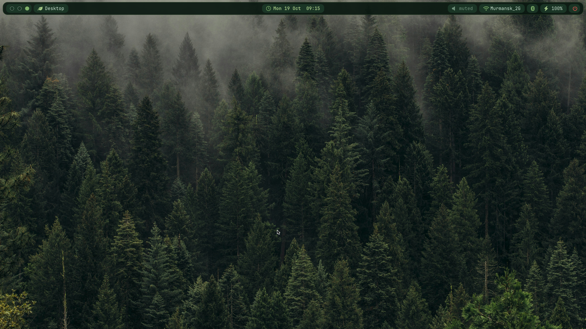

# nixos dots
 
My NixOS setup with [niri](https://github.com/YaLTeR/niri) and an [AGS](https://github.com/Aylur/ags) bar in a dark green forest palette.
 


## Install
 
1. Grab the files.
2. Replace `hardware-configuration.nix` with your own (`nixos-generate-config`).
3. Change the username and hostname
4. Put the files wherever you like and rebuild with flakes:
```bash
sudo nixos-rebuild switch --flake .#yourhostname
```
you can see and edit bindings in modules/niri.nix and shell aliases and extensions at modules/zsh.nix
 
